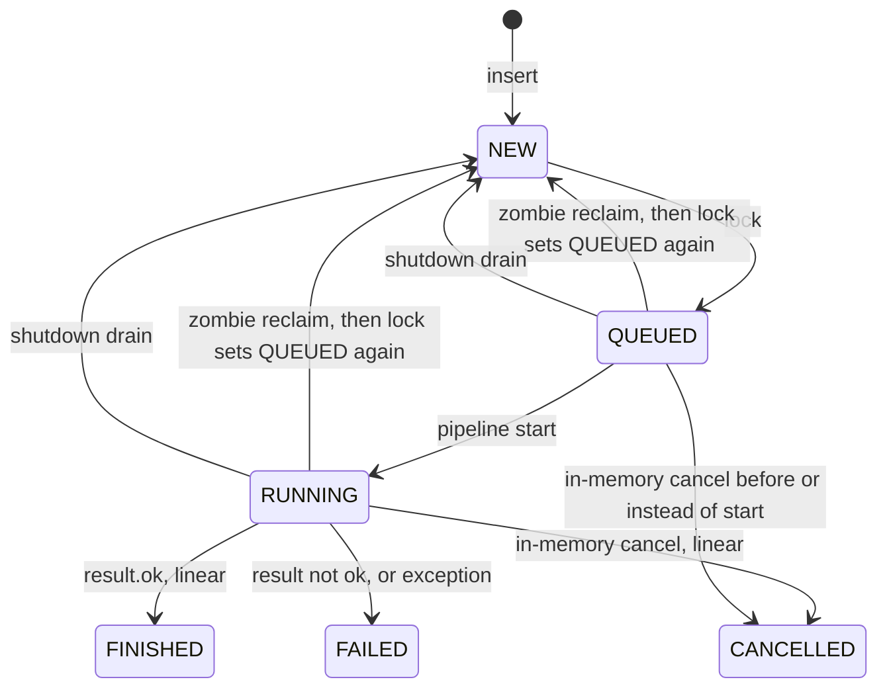

# Task status transitions

This is the status machine the worker actually writes. Roots and subtasks are rows in the same `tasks` table. A subtask is a row with `parent_id` set. `is_block` changes how a child failure affects the parent. `type_task` is `LINEAR` or `CYCLICAL`.

The library does not create subtasks. Plugins insert those rows. Broker ingress and `create_task` insert roots as `NEW`.

Source of the rules: `PostgresTaskStorage` and `PostgresTaskRepository`.

## Statuses

| Status | Terminal | Who moves a row here |
| --- | --- | --- |
| `DRAFT` | no | Nobody in the library. The value exists on the enum. The worker never reads it and never writes it. A `DRAFT` child is an open child for parent rollup. |
| `NEW` | no | Insert, cyclical requeue, shutdown drain. |
| `QUEUED` | no | Lock of a runnable row, including a zombie reclaim. |
| `RUNNING` | no | Start of a pipeline, and only from `QUEUED`. |
| `WAITING` | no | Root whose own pipeline succeeded while non-terminal children remain and no blocking child has failed. |
| `FINISHED` | yes | Own pipeline succeeded, and rollup (for a root) found nothing left to wait for or to fail on. |
| `FINISHED_WITH_ERROR` | yes | Root succeeded, every child is terminal, at least one non-blocking child failed, no blocking child failed. |
| `FAILED` | yes | Own pipeline failed, or a blocking child failed and that failure was applied to the parent. |
| `CANCELLED` | yes | In-memory cancel of a linear task, or an open sibling cancelled after a blocking failure. |

Terminal statuses are `FINISHED`, `FINISHED_WITH_ERROR`, `FAILED`, `CANCELLED`. A result persist updates a row only when its status is outside that set. Zero rows means the result is not inserted and later parent updates from that persist are skipped.

Open statuses for sibling cancel are `NEW`, `QUEUED`, `RUNNING`. `WAITING` and `DRAFT` are not cancelled by that update.

A row is runnable when `deleted_at` is null, `worker_enabled` is `1`, `pipeline_active_{scenario}` is `1`, `scenario` is non-empty, and either:

- status is `NEW` and `next_run_at` is null or due, or
- status is `QUEUED` or `RUNNING` and the heartbeat (or `updated_at`) is older than the zombie timeout.

`DRAFT` and `WAITING` are not locked.

## Shared path

Same edges for a root and a subtask, before parent rollup and before the cyclical rewrite.

| From | To | When |
| --- | --- | --- |
| `NEW` | `QUEUED` | Lock. Heartbeat is set. |
| `QUEUED`, `RUNNING` | `QUEUED` | Zombie reclaim. The same lock statement. |
| `QUEUED` | `RUNNING` | `mark_task_running`. Alias and root `steps_names` are written in that update. |
| `CANCELLED` (or anything other than `QUEUED`) | unchanged | `mark_task_running` updates 0 rows and raises `PipelineCancelledError`. The pipeline does not start. |
| non-terminal | `FINISHED` | `result.ok` is true. Cyclical rewrite and root rollup may replace this before the write. |
| non-terminal | `FAILED` | `result.ok` is false, or the pipeline raised and the task was not cancelled. |
| non-terminal | `CANCELLED` | The task's cancel event is set (worker disabled, scenario paused, or shutdown seen as a pipeline cancel). |
| non-terminal in-flight id, including `WAITING` | `NEW` | Shutdown timeout. Heartbeat is cleared. Terminal rows are left alone. |

Heartbeat updates touch only `QUEUED` and `RUNNING`.

A later persist does not overwrite a terminal row. That covers a success or error write that loses the race with cancel.

## Cyclical rewrite

Runs for `type_task = CYCLICAL` on every persist, after the candidate status above and before the row is written. `current_executions` increments by one on that persist.

| Candidate | Stored status | Condition |
| --- | --- | --- |
| `FINISHED` | `NEW` | `max_executions` is null, or `current_executions` after the increment is still below the cap. `next_run_at` becomes now plus `interval_seconds` (`0` when the interval is null). The task payload is written back. |
| `FINISHED` | `FINISHED` | The cap is reached. That successful iteration ends the cycle. This rewrite does not set `next_run_at`. |
| anything else (`FAILED`, `CANCELLED`, …) | unchanged | Failures and cancellations do not requeue. |

`result.ok = true` asks for another iteration until the cap. `result.ok = false` stops the cycle as `FAILED`. An exception is a failed iteration and does not requeue. A cancel stays `CANCELLED`.

A cyclical row stored as `NEW` does not then go through root rollup and does not run the subtask-finished or subtask-failed parent handlers. Those handlers see only a stored `FAILED` or `FINISHED`.

## Root rollup

Applies only when `parent_id` is null and the status after the cyclical rewrite is still `FINISHED`. Child rows are locked in the same transaction as the parent update. First match wins.

| Children at that moment | Root is stored as | Also |
| --- | --- | --- |
| At least one blocking child in `FAILED` or `FINISHED_WITH_ERROR` | `FAILED` | Open children (`NEW`, `QUEUED`, `RUNNING`) are set to `CANCELLED` in the same transaction. |
| No such blocking failure, and at least one child is not terminal (`NEW`, `QUEUED`, `RUNNING`, `WAITING`, `DRAFT`, …) | `WAITING` | Children are left as they are. |
| Every child is terminal, and at least one non-blocking child is `FAILED` or `FINISHED_WITH_ERROR` | `FINISHED_WITH_ERROR` | |
| Otherwise | `FINISHED` | |

A root whose own pipeline fails is stored as `FAILED`. A successful cyclical root under the cap is stored as `NEW`, and rollup does not run. The library does not cancel children because the root itself failed.

A blocking child that fails while the root is still `RUNNING` does not flip the root yet. `fail_waiting_parent` updates only a `WAITING` row. The open siblings are still cancelled. The root becomes `FAILED` when its own successful persist runs the rollup above, or when a later child completion finds the root already `WAITING`.

## What a finished or failed subtask does to the parent

These updates run only when the child row was actually updated to `FAILED` or `FINISHED`. They no-op when the parent is not `WAITING`, except sibling cancel, which does not look at the parent status.

Blocking child stored as `FAILED`:

| Parent status | Parent becomes | Siblings |
| --- | --- | --- |
| `WAITING` | `FAILED` | `NEW` / `QUEUED` / `RUNNING` become `CANCELLED`. |
| anything else, including `RUNNING` | unchanged | Those same open siblings still become `CANCELLED`. |

Non-blocking child stored as `FAILED`, and no non-terminal children remain:

| Other children | Parent, if it is `WAITING` |
| --- | --- |
| A blocking child is `FAILED` or `FINISHED_WITH_ERROR` | `FAILED` |
| A non-blocking child is `FAILED` or `FINISHED_WITH_ERROR` | `FINISHED_WITH_ERROR` |
| Neither | unchanged |

If any child is still non-terminal, this handler returns without changing the parent.

Child stored as `FINISHED`, and no non-terminal children remain:

| Other children | Parent, if it is `WAITING` |
| --- | --- |
| A blocking child is `FAILED` or `FINISHED_WITH_ERROR` | `FAILED` |
| A non-blocking child is `FAILED` or `FINISHED_WITH_ERROR` | `FINISHED_WITH_ERROR` |
| Neither | `FINISHED` |

If any child is still non-terminal, the parent stays `WAITING` until a later completion.

`CANCELLED` children are terminal and are not failures. They do not by themselves move the parent to `FAILED` or `FINISHED_WITH_ERROR`.

## Cases the worker does not implement

- No edge writes `DRAFT`, and no edge reads it back into `NEW`. Promotion is up to the plugin that inserted the row.
- `WAITING` is not locked and is not put back on the queue when the last child finishes. A child completion closes it in place to `FINISHED`, `FINISHED_WITH_ERROR`, or `FAILED`.
- A root `FAILED` from its own pipeline does not cancel children.
- Rows with `deleted_at` are left out of child counts and out of sibling cancel. They do not keep the parent in `WAITING` and do not move it to `FAILED`.
